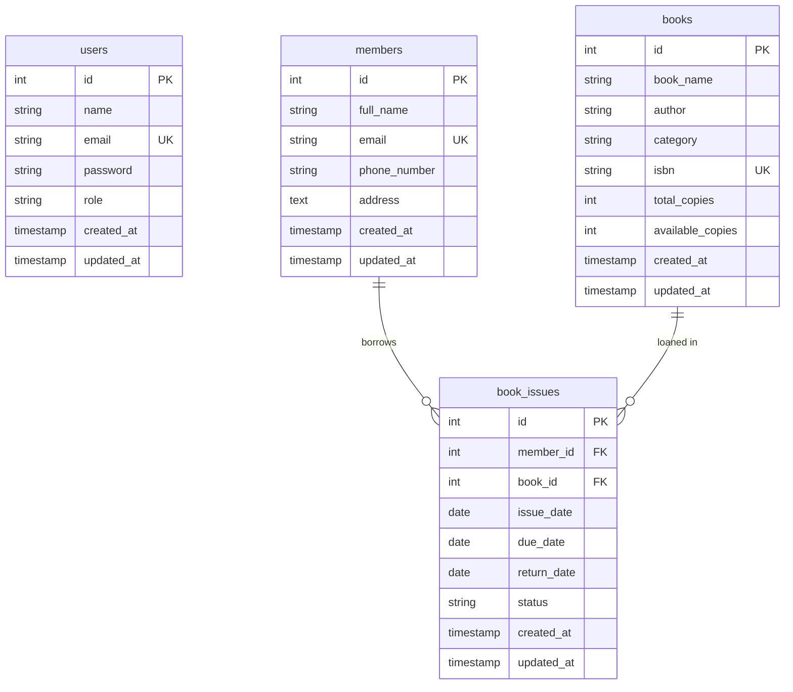

# Library Management System - Database Documentation

**Database Engine**: PostgreSQL 14+  
**Database Name**: `library_management_db`  
**Schema File**: [database/schema.sql](file:///c:/Users/monis/New%20Project/library-management-system/database/schema.sql)  
**Seed File**: [database/seed.sql](file:///c:/Users/monis/New%20Project/library-management-system/database/seed.sql)  
**Queries File**: [database/queries.sql](file:///c:/Users/monis/New%20Project/library-management-system/database/queries.sql)

---

## 1. Entity-Relationship Diagram (ERD)



---

## 2. Table Specifications

### 2.1 Table: `users`
Stores administrative staff accounts authorized to manage the library system.

| Column | Data Type | Constraints | Description |
| :--- | :--- | :--- | :--- |
| `id` | `SERIAL` | `PRIMARY KEY` | Auto-incrementing unique user identifier |
| `name` | `VARCHAR(100)` | `NOT NULL` | Full display name of the administrator |
| `email` | `VARCHAR(255)` | `NOT NULL, UNIQUE` | Login email address (case-insensitive indexing) |
| `password` | `VARCHAR(255)` | `NOT NULL` | Bcrypt hashed password (10 salt rounds) |
| `role` | `VARCHAR(20)` | `NOT NULL, DEFAULT 'admin', CHECK (role IN ('admin', 'librarian', 'member'))` | System role access tier |
| `created_at` | `TIMESTAMPTZ` | `DEFAULT CURRENT_TIMESTAMP` | Record creation timestamp |
| `updated_at` | `TIMESTAMPTZ` | `DEFAULT CURRENT_TIMESTAMP` | Auto-updated via trigger |

**Indexes**:
- `idx_users_email` on `users(email)` for fast authentication lookup.

---

### 2.2 Table: `books`
Stores the library's physical inventory and copy tracking.

| Column | Data Type | Constraints | Description |
| :--- | :--- | :--- | :--- |
| `id` | `SERIAL` | `PRIMARY KEY` | Auto-incrementing unique book identifier |
| `book_name` | `VARCHAR(255)` | `NOT NULL` | Title of the book |
| `author` | `VARCHAR(255)` | `NOT NULL` | Author(s) of the book |
| `category` | `VARCHAR(100)` | `NOT NULL` | Subject classification genre |
| `isbn` | `VARCHAR(20)` | `NOT NULL, UNIQUE` | Standard 10 or 13-digit ISBN code |
| `total_copies` | `INTEGER` | `NOT NULL, CHECK (total_copies > 0)` | Total physical copies owned |
| `available_copies` | `INTEGER` | `NOT NULL, CHECK (available_copies >= 0)` | Copies currently available on shelf |
| `CONSTRAINT` | `CHECK` | `CHECK (available_copies <= total_copies)` | Stock invariant: available $\le$ total |
| `created_at` | `TIMESTAMPTZ` | `DEFAULT CURRENT_TIMESTAMP` | Record creation timestamp |
| `updated_at` | `TIMESTAMPTZ` | `DEFAULT CURRENT_TIMESTAMP` | Auto-updated via trigger |

**Indexes**:
- `idx_books_isbn` on `books(isbn)`
- `idx_books_category` on `books(category)`
- `idx_books_name` on `books(book_name)`

---

### 2.3 Table: `members`
Stores registered library patrons who borrow books.

| Column | Data Type | Constraints | Description |
| :--- | :--- | :--- | :--- |
| `id` | `SERIAL` | `PRIMARY KEY` | Unique member ID |
| `full_name` | `VARCHAR(100)` | `NOT NULL` | Member's full legal name |
| `email` | `VARCHAR(255)` | `NOT NULL, UNIQUE` | Unique contact email |
| `phone_number` | `VARCHAR(20)` | `NOT NULL` | Contact phone number |
| `address` | `TEXT` | `NULL` | Optional physical address |
| `created_at` | `TIMESTAMPTZ` | `DEFAULT CURRENT_TIMESTAMP` | Enrollment date |
| `updated_at` | `TIMESTAMPTZ` | `DEFAULT CURRENT_TIMESTAMP` | Auto-updated via trigger |

**Indexes**:
- `idx_members_email` on `members(email)`
- `idx_members_phone` on `members(phone_number)`

---

### 2.4 Table: `book_issues`
Transaction junction table recording all book loans and returns.

| Column | Data Type | Constraints | Description |
| :--- | :--- | :--- | :--- |
| `id` | `SERIAL` | `PRIMARY KEY` | Unique loan transaction ID |
| `member_id` | `INTEGER` | `NOT NULL, REFERENCES members(id) ON DELETE RESTRICT` | Foreign key to member |
| `book_id` | `INTEGER` | `NOT NULL, REFERENCES books(id) ON DELETE RESTRICT` | Foreign key to book |
| `issue_date` | `DATE` | `NOT NULL, DEFAULT CURRENT_DATE` | Date book was checked out |
| `due_date` | `DATE` | `NOT NULL` | Due date for return |
| `return_date` | `DATE` | `NULL` | Actual date returned |
| `status` | `VARCHAR(20)` | `NOT NULL, DEFAULT 'issued', CHECK (status IN ('issued', 'returned', 'overdue'))` | Loan state |
| `CONSTRAINT` | `CHECK` | `CHECK (due_date >= issue_date)` | Due date must be on or after issue date |
| `CONSTRAINT` | `CHECK` | `CHECK (return_date IS NULL OR return_date >= issue_date)` | Return date cannot precede issue date |
| `created_at` | `TIMESTAMPTZ` | `DEFAULT CURRENT_TIMESTAMP` | Transaction timestamp |
| `updated_at` | `TIMESTAMPTZ` | `DEFAULT CURRENT_TIMESTAMP` | Auto-updated via trigger |

**Indexes**:
- `idx_book_issues_member_id` on `book_issues(member_id)`
- `idx_book_issues_book_id` on `book_issues(book_id)`
- `idx_book_issues_status` on `book_issues(status)`

---

## 3. Database Triggers

Every table uses an automated trigger function to maintain an accurate `updated_at` audit trail without requiring backend SQL code to manually pass timestamps:

```sql
CREATE OR REPLACE FUNCTION update_updated_at_column()
RETURNS TRIGGER AS $$
BEGIN
    NEW.updated_at = CURRENT_TIMESTAMP;
    RETURN NEW;
END;
$$ LANGUAGE plpgsql;
```

---

## 4. Referential Integrity & Foreign Key Rules

1. **Delete Protection (`ON DELETE RESTRICT`)**:
   - A member record **cannot be deleted** if there are referencing rows in `book_issues`.
   - A book record **cannot be deleted** if there are referencing rows in `book_issues`.
   - This prevents accidental data loss and preserves audit compliance.

2. **Transaction Isolation**:
   - Issue and return operations run inside PostgreSQL transactions (`BEGIN ... COMMIT`) with row-level locks (`SELECT ... FOR UPDATE`) to prevent race conditions during concurrent borrowing.
